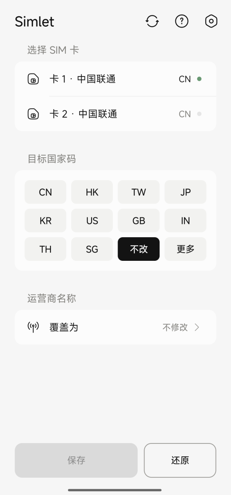
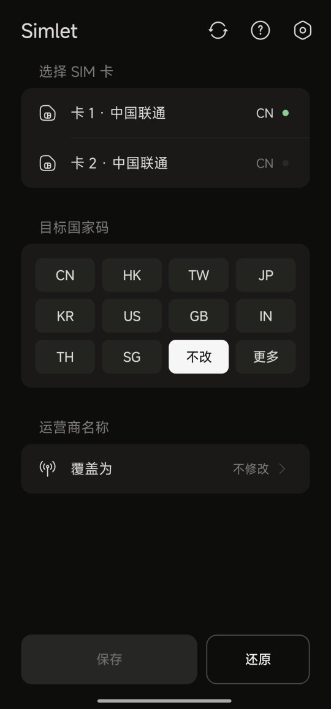
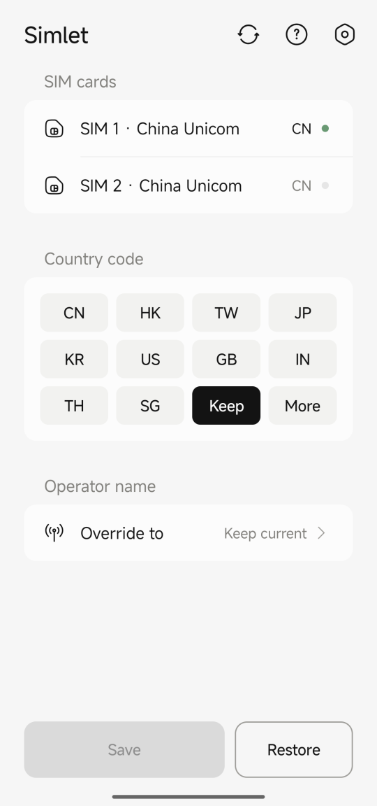
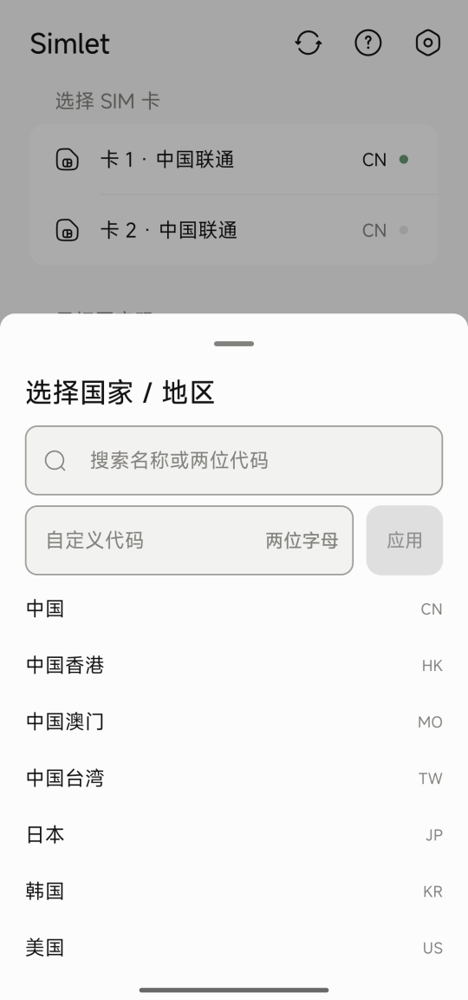
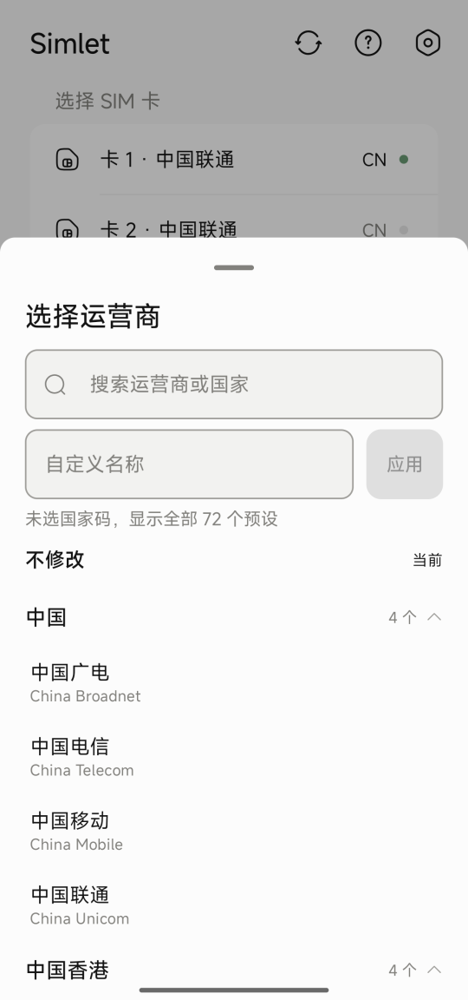
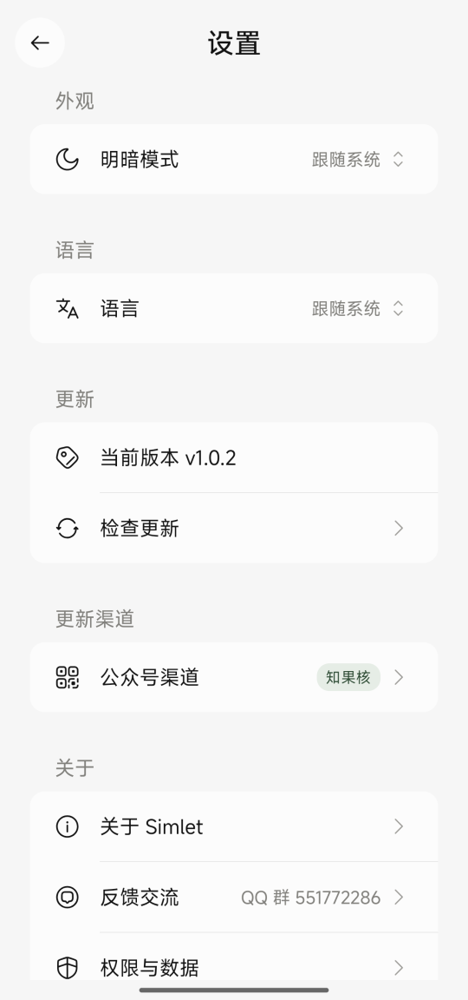

# Simlet

<p align="center">
  
</p>

我做的小工具：**不 Root，改的是手机「以为」你的 SIM 卡来自哪里。**

Android 会把 SIM 卡上报的国家码和运营商名交给各种应用去判断你在哪、用的是哪家运营商。Simlet 改的就是这份上报——不写卡、不动基带、不绕过任何鉴权，随时一键还原。

[](LICENSE)


> 用途是解除按 SIM 地区判断的限制，或修正系统认错运营商地区导致的问题。它不会让受限的网络功能变得可用，也不改 ICCID / IMSI。

## 界面

| | | |
|:---:|:---:|:---:|
|  |  |  |
| 首页 · 双卡与目标国家码 | 深色档 | 中英随时切 |
|  |  |  |
| 国家码 · 搜索与自定义 | 运营商 · 按国家分组 | 外观与更新 |

## 你需要准备什么

Android 8.0 以上，加一个 **Shizuku 13.6.0 以上**（[下载](https://github.com/rushiranpise/Shizuku-Next)）——这是唯一的前置，不需要 Root，也不需要解锁 Bootloader。

> 我引导装的是 Shizuku-Next，社区维护的发行版，包名和 API 与官方一致；官方上游是 [RikkaApps/Shizuku](https://github.com/RikkaApps/Shizuku)。

## 上手

1. 装好 Shizuku 并启动，推荐「无线调试」方式。
2. 从 [Releases](https://github.com/vip458/Simlet/releases) 下载 `app-release.apk` 安装。
3. 打开 Simlet，在引导页点「请求授权」，弹窗里选允许。
4. 选卡 → 选目标国家码（比如 `JP`）→ 需要的话再改运营商名 → 点**保存**。
5. 想恢复原样：点**还原**。

| 想要的效果 | 怎么做 |
| --- | --- |
| 让手机以为卡在东京 | 卡 1 → 国家码 `JP` → 保存 |
| 状态栏显示自己的名字 | 运营商名称 → 自定义名称填 `MyCarrier` → 应用 → 保存 |
| 目录里没有的地区 | 国家码 → 更多 → 自定义代码填两位 ISO |
| 两张卡给不同地区 | 分别设置，互不影响 |
| 全部恢复 | 逐张卡点还原 |

不申请任何运行时权限，唯一一次例外是配了自建后台的构建会在第一次有公告可提醒时问一次通知权限（拒了照常，见 [docs/privacy.md](docs/privacy.md)）；SIM 相关的数据只存本机；网络请求只有你主动点「检查更新」时那一次，以及可选的每天一条匿名使用统计（设置里可以关掉，同上）。安装包约 1.3 MB。

## 它是怎么工作的

改的是 `system_server` 里的运营商配置（CarrierConfig），不碰卡本身，所以可以完全还原。写入走三级回退，每一级写完都会读回来确认真正生效：

| | 通道 | 适用 |
| --- | --- | --- |
| 一 | `ICarrierConfigLoader.overrideConfig` | Android 8 – 15 |
| 二 | 借 shell 身份调 `CarrierConfigManager.overrideConfig` | Android 16+ |
| 三 | 由 shell 拉起独立进程执行通道二 | 主进程借不到权限时 |

写入一律是会话级（`persist=false`）。Android 16/17 上普通应用请求持久写入，要么被直接拒，要么「收下但不落盘」——读得到值，下次配置重载却整个丢掉，反而更难判断。所以我明确不持久，重启后由开机补写恢复你的设置。

```
app/src/main/java/com/qianxi/simlet/
├── core/     机制层：三级写入通道、shell 权限委托、卡槽读取、写后校验、开机补写
├── data/     国家目录与按国家分组的运营商预设
├── update/   检查更新、下载、拉起系统安装器
├── ui/       Compose 界面：首页 / 引导页 / 设置 / 关于 / 开源许可
└── licenses/ 开源许可清单（tools/gen-licenses.py 生成）
```

## 已知限制

- 部分定制系统（如鸿蒙）在框架层禁掉了相关接口，用不了属正常现象
- 覆盖是会话级的：系统重载配置或重启后会短暂回落到真实运营商，再由开机补写恢复
- 还原是两步——先把该卡的真实国家码写回去，再清空覆盖。因为系统只在「写入新覆盖」时重算派生出来的 `countryIso`，光清空的话应用还会读到旧值
- 状态栏运营商名跟随依赖 `setOperatorBrandOverride`，各家放行情况不一：我的小米 15（Android 17）跟随，红米 Note 14 Pro（Android 16）被系统拒绝——那种情况下国家码和配置覆盖照样生效，只是名字不变
- 个别机型主进程借不到 shell 权限，会自动落到通道三完成，写入多花几秒

## 读不到卡？

首页显示「未检测到可用 SIM 卡」时，先确认卡插好了、SIM 没被 PIN 码锁住——锁着的话系统还没有活跃订阅，任何应用都读不到它。

还不行，看提示下面那行灰色小字，那是读卡通道自己报的原因，比如 `dumpsys isub 没有输出（exit=1 ...）`，或者 `dumpsys isub 有 132 行，但没解析出卡槽映射`。**把那一行连同机型、系统版本发到下面的群里**，比只说「识别不到卡」有用得多：各家 ROM 的打印格式不一样，我没有样本就修不到那一台。

## 更新日志

### v1.0.2

- 反馈入口支持直接跳转 QQ 加群

### v1.0.1

- 修复部分机型识别不到 SIM 卡的问题
- 识别不到卡时显示原因，方便反馈定位
- 反馈入口移到设置页
- 更换应用图标
- 修复更新弹窗内容过长、下载按钮被顶出屏幕的问题

### v1.0.0 · 2026-10-30

第一个公开版本：修改 SIM 卡上报的国家码和运营商名称，支持一键还原。

- 双卡分别设置
- 支持 Android 8 – 17
- 开机自动恢复设置
- 内置 72 个运营商预设，支持自定义名称
- 深色模式三档、中英文切换
- 应用内检查更新

## 数据与隐私

改 SIM 配置这件事本身完全在本机完成：国家码、运营商名称、保存的覆盖方案只写进应用的私有目录，不上传、不同步、不导出。卸载即干净。

会离开手机的只有这几类请求：

| 请求 | 内容 | 什么时候发 |
| --- | --- | --- |
| 检查更新 | 读 GitHub Releases 的公开接口，匿名 | 只在你点「检查更新」时，应用不会自己查 |
| 自建后台 · 配置 | 拉公告和更新信息，不带设备标识 | 构建时配了后台地址才会发，一天最多一次 |
| 自建后台 · 统计 | 每天一条匿名上报 | 同上，且设置里的统计开关没关 |

匿名统计只有四样东西：一个本机随机生成的匿名 ID、机型、Android 版本、应用版本。没有手机号、IMSI、ICCID、位置，也没有你填的任何 SIM 内容。上报字段、服务器保留期、关闭方式都写在 [docs/privacy.md](docs/privacy.md) 里。

那个后台是我自己跑的、不开源，但它和客户端之间只有一条公开文档化的 HTTP 接口，接口定义在本仓库 [docs/api-contract.md](docs/api-contract.md)。`HUB_BASE_URL` 留空（也就是你按下面「自己编译」出来的默认包）时，这两个后台请求一个都不发，公告位和统计开关整排都不出现——检查更新会自动退回直接读 GitHub，功能不受影响。fork 这个项目的人改一行就能指向自己的服务器，或者干脆不联网。

## 反馈

QQ 群 **551772286**，在 QQ 里按群号搜就行（我不放「一键加群」那种链接：它的 `busi_data` 里带着群主 uin 和 token，写进公开仓库等于把它们公开）。提问麻烦带上机型、系统版本、Shizuku 版本，以及首页那行灰字。

发版通知我发在公众号 **知果核**，安装包一律以本仓库 Releases 为准。


## 自己编译

```bash
./gradlew assembleDebug      # 调试包
./gradlew assembleRelease    # 发布包（R8 混淆 + 资源压缩）
```

没有签名配置时 `assembleRelease` 也会成功，只是产出未签名包。要出可安装的发布包：

```bash
cp keystore.properties.example keystore.properties   # 填你自己的 keystore
./gradlew assembleRelease
```

`keystore.properties` 和 `*.jks` 都在 `.gitignore` 里，口令不进仓库。国内网络若拉不动 Gradle 发行包，把 `gradle/wrapper/gradle-wrapper.properties` 里的 `distributionUrl` 换成官方的 `https\://services.gradle.org/distributions/gradle-8.9-bin.zip`。

想接自己的后台（接口见 [docs/api-contract.md](docs/api-contract.md)）：

```bash
./gradlew assembleRelease -PhubBaseUrl=https://your.host/simlet-api
```

地址填到目录为止，不带 `/api`。不加这个参数就是默认值——空字符串，此时公告、更新推送、匿名统计整套都不出现，一个请求也不发，检查更新退回直接读 GitHub。

## 贡献

改动请顺手遵守仓库风格：注释用中文、只在「为什么」不显然的地方写、界面文案一律走 `strings.xml`（`values-en` 同步补）。

- 加界面图标：见 [docs/icons-reicon.md](docs/icons-reicon.md)，统一来自 [Reicon](https://reicon.dev) 子集，`python tools/gen-icons.py` 重新生成
- 加依赖后：跑 `python tools/gen-licenses.py` 重生成关于页的许可清单，别手改生成物
- 应用图标与品牌源文件在 `brand/`，改设计请连同 `app/src/main/res/` 下的启动图标一起更新

## 鸣谢

- [Shizuku](https://github.com/RikkaApps/Shizuku) — 免 Root 拿到 shell 能力的全部前提
- [Reicon](https://reicon.dev) — 界面图标（MIT）
- [Ackites Nrfr](https://github.com/Ackites/Nrfr) — 同类机制的先行者。Simlet 是独立实现，不含它的代码，但「这条路在 Android 16/17 上还走得通」最早是在它上面验证的

## 许可

Apache License 2.0 — 详见 [LICENSE](LICENSE)。应用内「设置 → 关于 Simlet → 开源许可」列出全部直接依赖及其条款。
