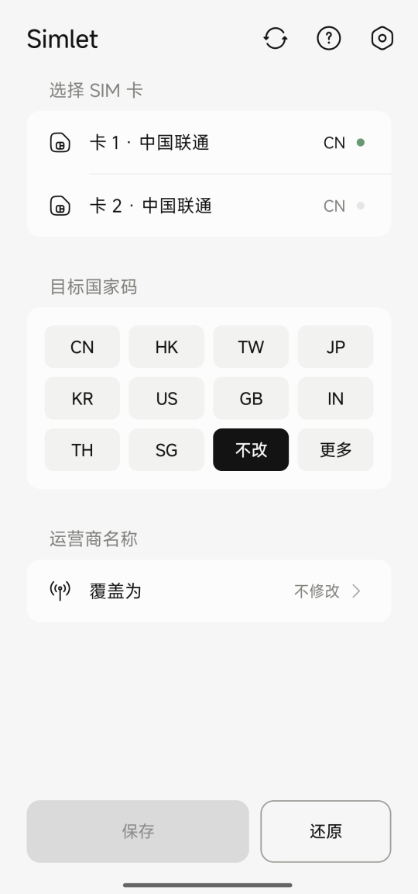
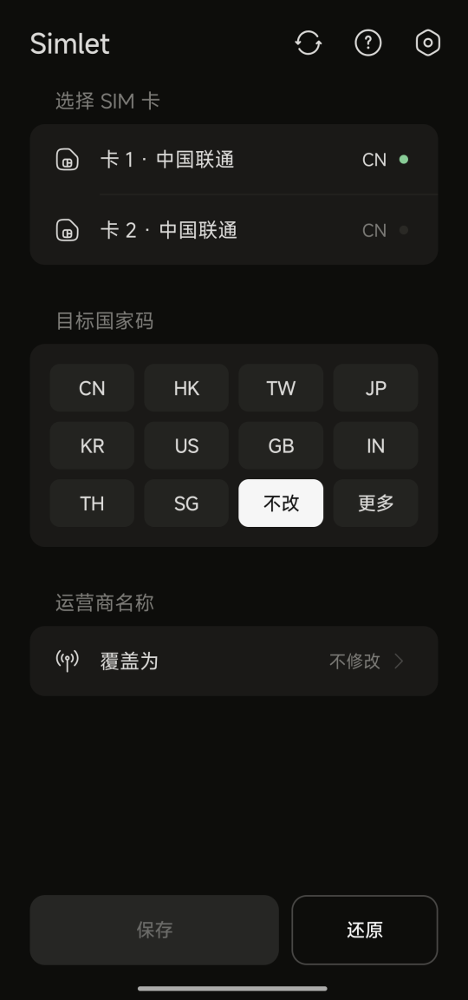
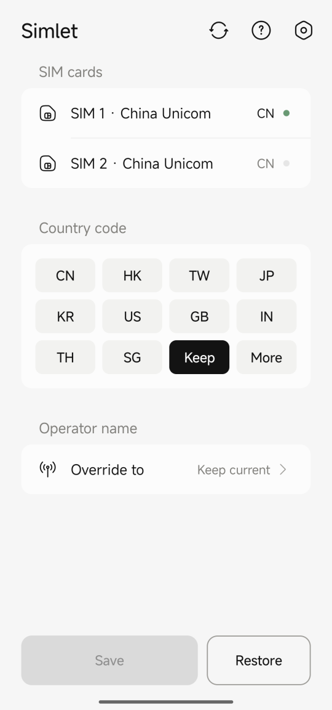
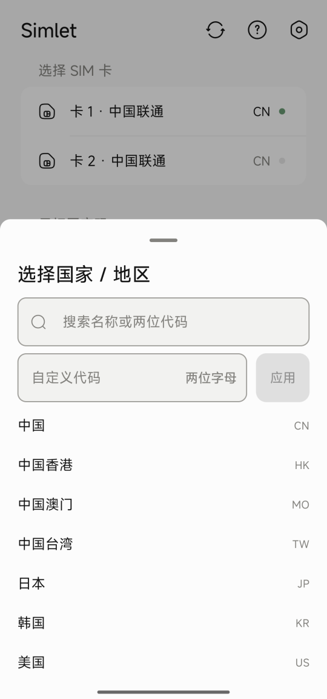
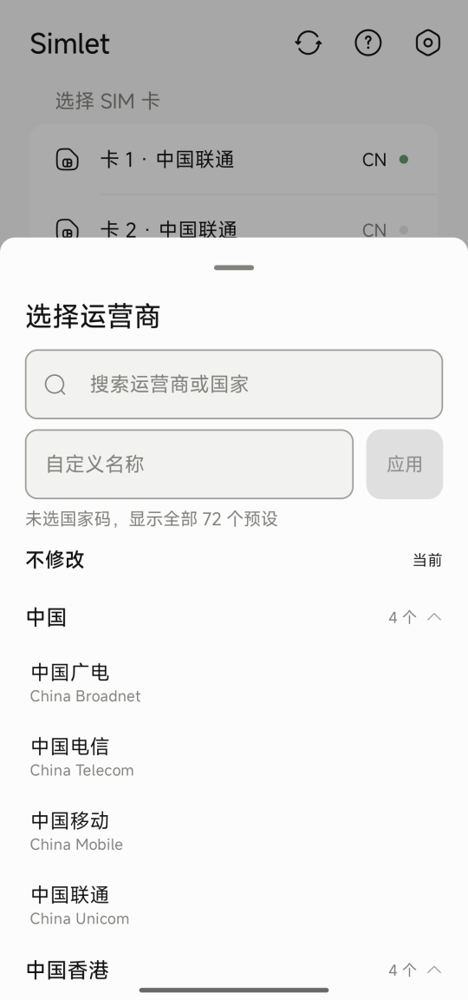
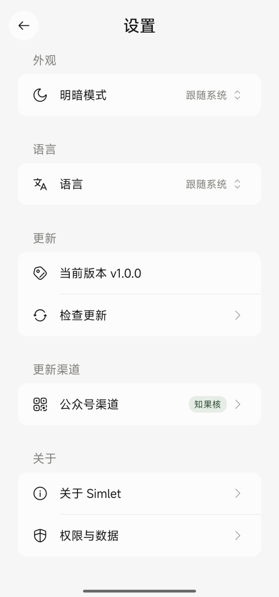
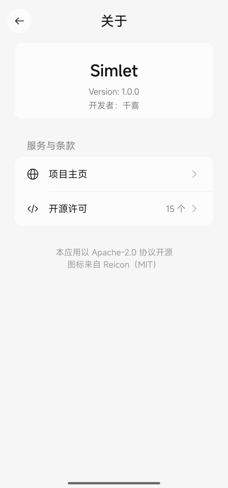
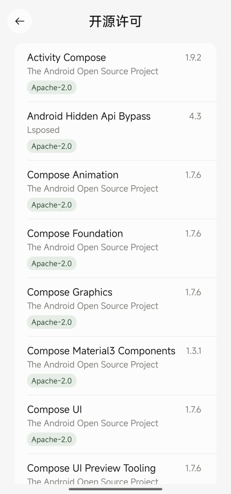
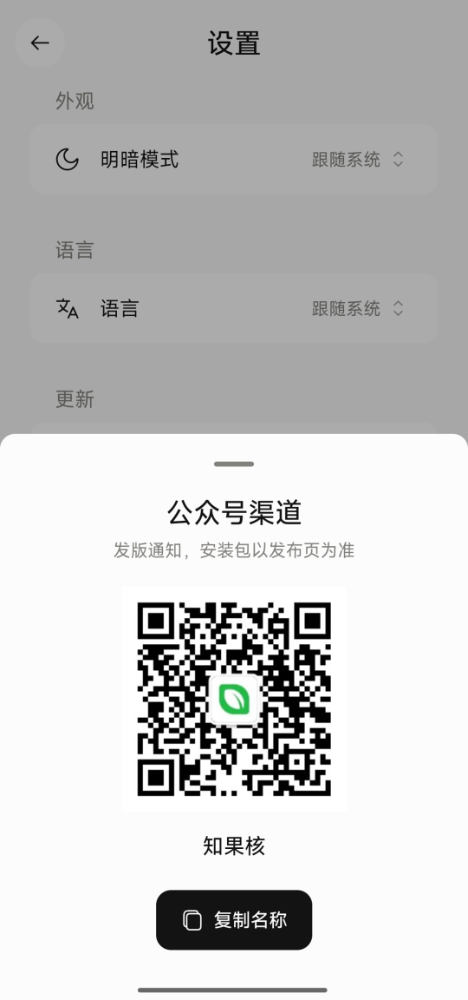

# Simlet

免 Root 修改系统读取到的 SIM 卡国家码与运营商名称。

**No-root SIM country / carrier-name override for Android, powered by Shizuku.**
It rewrites what `system_server` reports about your SIMs — never the SIM itself — so it is fully reversible.

[](LICENSE)


> **请先读这一条**：本应用改的是运营商配置在系统里的**呈现**，用来解除按 SIM 地区判断的限制、或修正系统识别错运营商地区导致的问题。它不写卡、不解锁基带、不绕过任何运营商的鉴权，也不会让受限网络功能变得可用。改动随时可一键还原，重启后默认回落到真实运营商。

---

## 界面

| | | |
|:---:|:---:|:---:|
|  |  |  |
| 首页 · 双卡与目标国家码 | 深色档 | 内置中英文切换 |
|  |  |  |
| 国家码弹层 · 搜索与自定义 | 运营商弹层 · 按国家分组 | 设置 · 外观 / 语言 / 更新 |
|  |  |  |
| 关于页 | 开源许可 · 逐条可跳转 | 发版通知渠道 |

---

## 能做什么

- 把 SIM 卡在系统内上报的国家/地区码改成任意两位 ISO（如 `jp`、`us`）
- 覆盖状态栏与系统读取到的运营商名称，内置按国家分组的 72 个预设，也支持任意自定义名称
- 双卡分别设置，互不影响；随时一键还原
- 重启后自动补写一次，不需要重复操作
- 明暗三档、中英双语、检查更新（GitHub Releases）

## 不做什么

- 不写 SIM 卡本身，不做 EF/AD 等卡内文件定制，不改 ICCID/IMSI
- 不需要 Root，也不需要解锁 Bootloader；但没有 **Shizuku** 就用不了——这是唯一的前置
- 不申请任何运行时权限；除「检查更新」外不发任何网络请求，配置只存本机

## 环境要求

| | |
| --- | --- |
| 系统 | Android 8.0（API 26）及以上 |
| 依赖 | [Shizuku](https://github.com/RikkaApps/Shizuku-Releases) **13.6.0 以上**（Android 16/17 必需，低版本没有权限委托能力） |
| 存储 | 安装包约 1.3 MB（R8 混淆 + 资源压缩后实测），配置只存本机 |

## 快速上手

1. **装 Shizuku 并启动**。推荐「无线调试」方式，一次配对、重启后需重新启动。
2. **装 Simlet**。从 [Releases](https://github.com/vip458/Simlet/releases) 下载 `app-release.apk` 安装；或照下面[构建](#构建)自己出包。
3. 打开 Simlet，在引导页点「请求授权」，在 Shizuku 的授权弹窗里点允许。授权成功后引导页会自动换成首页。
4. 首页选卡 → 点目标国家码（例如 `JP`）→ 需要的话再改运营商名称 → 点右下角**保存**。
5. 想恢复原样：点**还原**。它是两步——先把该卡真实国家码写回去，再清空覆盖，这样应用侧读到的派生值也停在真值上。

> 保存/还原都是**会话级**覆盖，不写卡。系统重载配置或重启后会自动回落到真实运营商，由开机补写恢复你设定的值。

## 使用示例

| 想要的效果 | 操作 |
| --- | --- |
| 让系统以为卡在东京 | 卡 1 → 目标国家码 `JP` → 保存 |
| 状态栏显示自定义运营商名 | 运营商名称 → 自定义名称里输入 `MyCarrier` → 应用 → 保存 |
| 用任意两位代码（目录里没有） | 目标国家码 → 更多 → 自定义代码里输入两位 ISO → 应用 |
| 双卡给不同地区 | 卡 1 选 `US`、卡 2 选 `HK`，分别保存，互不影响 |
| 全部恢复 | 逐张卡点还原 |

## 工作原理

修改的是 `system_server` 内的运营商配置（CarrierConfig），不写 SIM 卡本身，因此对卡片无损伤、可完全还原。

写入按三级回退，逐级尝试并在写后用读回校验确认真正生效：

| 级别 | 通道 | 适用系统 |
| --- | --- | --- |
| 一 | 直接调用 `ICarrierConfigLoader.overrideConfig` | Android 8 – 15 |
| 二 | 借取 shell 权限身份后调用 `CarrierConfigManager.overrideConfig` | Android 16+ |
| 三 | 由 shell 拉起独立 instrumentation 进程执行通道二 | 个别 ROM 拒绝主进程委托时 |

写入一律使用会话级覆盖（`persist=false`）：Android 16/17 上普通应用请求 `persist=true` 要么直接被拒，要么「收下但不落盘」——读回能看到值，下一次配置重载却整个丢掉，反而更难判断。丢失后由开机补写恢复。

实测记录（Xiaomi 15 / Android 17 与 Redmi Note 14 Pro / Android 16，均 Shizuku 14.0.27）：通道一按预期被拒（`overrideConfig cannot be invoked by shell`）；通道二的 `startDelegateShellPermissionIdentity` 调用不报错，但应用进程内权限自检仍为未授予——这两台机型的框架只允许 shell 自己拉起的进程借权，因此会自动落到通道三完成写入，功能不受影响，仅每次写入多耗几秒。通道二在部分原生/类原生 Android 16 上会真正生效。

## 构建

```bash
# 需要 JDK 17+ 与 Android SDK（platform 36、build-tools 36）
./gradlew assembleDebug      # 调试包
./gradlew assembleRelease    # 发布包（R8 混淆 + 资源压缩）
```

未配置签名时 `assembleRelease` 也会成功，只是产出 `app-release-unsigned.apk`。要出可安装的发布包：

```bash
cp keystore.properties.example keystore.properties   # 填你自己的 keystore 路径与口令
./gradlew assembleRelease
```

`keystore.properties` 和 `*.jks` 都在 `.gitignore` 里，口令不进仓库。

> Gradle 发行包默认走腾讯镜像（`gradle/wrapper/gradle-wrapper.properties`）。海外网络可把 `distributionUrl` 换成 `https\://services.gradle.org/distributions/gradle-8.9-bin.zip`。

## 目录结构

```
app/src/main/java/com/qianxi/simlet/
├── SimletActivity.kt          # 单 Activity 入口：Shizuku 状态机 + 页面栈 + 切屏动画
├── core/                      # 机制层
│   ├── ShizukuLink.kt         #   连接、授权、shell 命令、binder 代理
│   ├── HiddenAccess.kt        #   非公开接口豁免
│   ├── SystemServices.kt      #   系统服务反射取用
│   ├── LoaderChannel.kt       #   通道一
│   ├── ShellIdentity.kt       #   通道二的权限委托
│   ├── ManagerChannel.kt      #   通道二
│   ├── SimletOverrideJob.kt   #   通道三入口（Instrumentation）
│   ├── JobLauncher.kt         #   通道三启动器
│   ├── OverrideWriter.kt      #   三级回退总控 + 写后校验
│   ├── SlotReader.kt          #   卡槽映射与当前配置读取
│   ├── OverrideDump.kt        #   解析 dumpsys carrier_config 的覆盖块
│   ├── RegistryDump.kt        #   解析系统实际上报的运营商名
│   ├── SubscriptionSync.kt    #   状态栏运营商名跟随
│   └── PlanStore.kt           #   期望配置持久化与开机补写
├── model/                     # SimSlot / OverridePlan
├── data/                      # 国家目录、按国家分组的运营商预设
├── boot/                      # 开机补写（Receiver + JobService）
├── update/                    # 检查更新、下载、拉起安装器
├── licenses/                  # 开源许可清单（由 tools/gen-licenses.py 生成）
└── ui/
    ├── SimletViewModel.kt     # 界面状态与异步读写
    ├── L10n.kt                # 应用内语言切换
    ├── theme/                 # 色板、形状、主题
    ├── component/             # 卡片行、徽章、国家码栅格、底部弹层
    └── screen/                # 首页 / 引导页 / 设置 / 关于 / 开源许可
```

## 已知限制

- 部分定制系统（如鸿蒙）在框架层禁用了相关接口，无法生效属正常现象
- 部分机型（实测 Xiaomi 15 / Android 17、Redmi Note 14 Pro / Android 16）主进程借不到 shell 权限，会自动由通道三完成，写入耗时略增
- 覆盖是会话级的：配置被系统重载或重启后会回落到真实运营商，由开机补写恢复，期间存在短暂窗口
- 系统只在「写入新覆盖」时重算派生出来的 `countryIso`：只把覆盖清空（还原），应用侧仍会读到上一次的国家码，实测开关一次飞行模式也不会重算。所以还原是两步——先写回该卡真实国家码（非漫游时取 `gsm.operator.iso-country`），再清空覆盖
- 运营商名跟随依赖 `setOperatorBrandOverride`，实测 Xiaomi 15 / Android 17 放行（状态栏与 `ServiceState.mOperatorAlphaLong` 会跟随新名称），Redmi Note 14 Pro / Android 16 被系统拒绝（`Permission Denial: transactRemote ... requires permission`）；此时国家码与配置覆盖仍然生效，只是状态栏名称不变
- `dumpsys isub` 里的 carrierName 始终不随品牌覆盖变化，判断是否跟随要看 `dumpsys telephony.registry` 的 `mOperatorAlphaLong`
- 通道三依赖「应用进程已在运行」：Shizuku 是把 binder 通过应用自己的 ContentProvider 递进来的，若应用进程被系统杀掉后单独拉起 instrumentation 进程，该进程里取不到 binder（报 `Shizuku 未就绪`）。从界面点保存/还原时应用本来就在前台，不受影响；开机补写走的是应用自身的进程，也不受影响

## 贡献

改动请顺手遵守仓库现有风格：注释用中文、只在「为什么」不显然的地方写注释、界面文案一律走 `strings.xml`（`values-en` 同步补）。

- 加图标：见 [docs/icons-reicon.md](docs/icons-reicon.md)，图标统一来自 [Reicon](https://reicon.dev) 子集，用 `python tools/gen-icons.py` 重新生成
- 加依赖后：跑 `python tools/gen-licenses.py` 重生成关于页的许可清单，别手改生成物

## 鸣谢

- [Shizuku](https://github.com/RikkaApps/Shizuku) — 免 Root 拿到 shell 能力的全部前提
- [Reicon](https://reicon.dev) — 界面图标（MIT，vendored 子集见 `app/src/main/java/dev/reicon`）
- [Ackites Nrfr](https://github.com/Ackites/Nrfr) — 同类机制的先行者；Simlet 是独立实现，不含其代码，但「这条路在 Android 16/17 上走得通」最早是在它上面验证的

## 许可

Apache License 2.0 — 详见 [LICENSE](LICENSE)。应用内「设置 → 关于 Simlet → 开源许可」列出全部直接依赖及其条款。

关注公众号 **知果核** 获取发版通知（安装包仍以本仓库 Releases 为准）：


